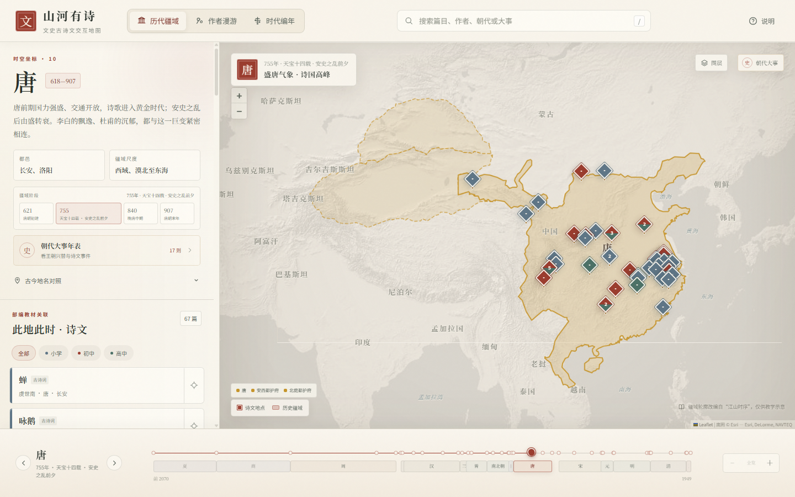
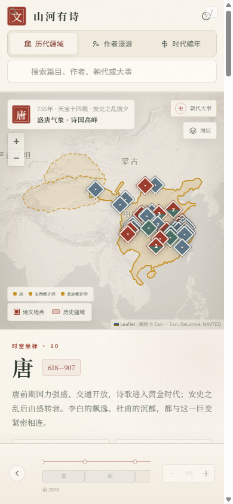

# 山河有诗 · 文史古诗文交互地图

[](https://github.com/Williamme/shanhe-you-shi/actions/workflows/validate.yml)

面向小学高年级至高中学生的语文、历史跨学科轻量教具。项目把教材古诗文、作者行旅、历史疆域与时代大事放在同一套可检索的时空框架中，帮助学生理解作品、人物与时代之间的关系。

[在线体验](https://182.92.198.247/shanhe-you-shi/) · [GitHub 仓库](https://github.com/Williamme/shanhe-you-shi) · [数据说明](#数据说明) · [参与贡献](CONTRIBUTING.md) · [开源许可](#开源许可)



<p align="center">
  
</p>

## 核心功能

### 历代疆域

- 覆盖夏、商、周、秦、汉、三国、晋、南北朝、隋、唐、宋、元、明、清和近现代。
- 当前收录 15 个历史时期、39 个分阶段疆域快照。
- 每个朝代支持多阶段切换，例如唐朝可查看 `621`、`755`、`840`、`907` 年疆域。
- 支持真实年代尺度时间轴，显示朝代色带和疆域阶段点。
- 时间轴支持 `− / 全览 / ＋` 缩放，也支持 `Ctrl/Command + 滚轮` 缩放。
- 地图图层可独立显示或隐藏：
  - 历史疆域
  - 诗文地点
  - 古今地名
  - 浅色地形
  - 现代省界
- 点击地图上的诗文地点，可查看该地关联的全部篇目。
- 支持按小学、初中、高中筛选篇目。

### 作者漫游

- 将作者漫游资料与时代编年人物档案自动合并。
- 当前运行时展示 60 位作者，包括两套资料中的全部作者。
- 按生平时间绘制迁徙、宦游、被贬和游历路线。
- 每个行旅节点展示年代、今古地名、旅行缘由和生平故事。
- 点击节点可查看该地写下的诗文。
- 支持作者讲解视频链接，并可从 `detail.txt` 一键重新同步。

### 时代编年

- 以纵向年代轴展示并行政权、历史大事和课内作者。
- 并行政权自动分配时间泳道。
- 支持全局搜索朝代、作者和历史事件。
- 历史事件与历代疆域大事年表自动合并。
- 事件详情展示起因、过程、结果、意义和评价。

### 诗文阅读

- 原文与白话译文双栏阅读。
- 重点注释与时代背景独立展示。
- 通假字按原句精确定位并着色，点击后显示本字、读音、释义、原句与译文。
- 支持从诗文详情跳转到创作地图或作者一生行旅。

## 数据概览

| 内容 | 数量 |
| --- | ---: |
| 历史时期 | 15 |
| 疆域阶段快照 | 39 |
| 原始作者资料 | 51 |
| 合并后运行时作者 | 约 60 |
| 教材诗文 | 159 |
| 朝代大事 | 119 |
| 事件详细解读 | 36 组 |
| 通假字条目 | 91 |
| 中文地图标注 | 80 |

历史疆域与政区仅为教学示意，并非测绘成果。不同史学版本对年代、疆界和政权称谓存在差异。

## 技术栈

- HTML5
- CSS3 / TailwindCSS CDN
- 原生 JavaScript ES Modules
- Leaflet 1.9
- GeoJSON
- 零依赖 Node.js 本地静态服务器
- 可选 Node.js 匿名访客统计服务

## 本地运行

需要 Node.js 18 或更高版本。

```bash
git clone https://github.com/Williamme/shanhe-you-shi.git
cd shanhe-you-shi
npm start
```

也可以只通过 npm 启动：

```bash
npm start
```

打开 <http://localhost:4173>。Windows 也可以运行 `start.bat`。

检查全部数据：

```bash
npm run check
```

浏览器在 `file://` 协议下通常会阻止读取 JSON，请通过本地 HTTP 服务访问。

## 项目结构

```text
index.html                         页面结构与三个核心模块
css/styles.css                     书卷风视觉、响应式布局和地图样式
js/app.js                          地图、筛选、搜索、作者漫游和事件交互
js/era-timeline.js                 时代编年纵轴与并行泳道
js/content-union.js                作者资料和大事件年表的运行时合并
visitor-server.cjs                 独立访客统计服务
visitor-store.cjs                  匿名访客哈希、去重和持久化

data.json                          朝代、作者、路线、诗文和中文地图标注
data/map-atlas.json                分阶段疆域索引
data/atlas/*.geojson               疆域快照和并行政权
data/geo/*.geojson                 早期疆域示意层
data/modern-provinces.geojson      可选现代省界
data/chronicles.json               朝代大事年表
data/history-event-details.json    事件起因、过程、结果、意义和评价
data/era-timeline.json             时代编年原始资料
data/tongjia.json                  通假字、原句与篇目关联
data/author-links.json             作者视频链接索引

文言文.txt                         教材篇目和通假字源材料
detail.txt                         作者视频链接源材料
时代轴.html                        时代编年源材料
```

## 数据说明

### 新增诗文

在 `data.json` 的 `works` 数组中加入对象。`dynastyId` 必须对应 `dynasties[].id`，地图点位使用 `place.lat` 与 `place.lng`。

### 新增作者

在 `data.json` 的 `authors` 数组中加入作者和 `route`。行旅节点可通过 `workIds` 关联多篇诗文。

### 新增疆域阶段

1. 将 GeoJSON 放入 `data/atlas/`。
2. 在 `data/map-atlas.json` 对应朝代的 `snapshots` 数组中加入年份、标签和路径。
3. 运行 `npm run check` 校验文件与结构。

历史图层建议包含 `name`、`role` 和 `color` 属性。`role` 支持：

- `primary`：当前主要政权
- `context`：并行政权
- `neighbor`：周边政权

### 通假字

在 `文言文.txt` 末尾按以下格式维护：

```text
通假字（本字）｜释义｜原句｜译文｜篇目
```

随后运行：

```bash
npm run import:tongjia
```

### 作者视频

在 `detail.txt` 中按 `作者名：视频链接` 添加。运行：

```bash
npm run sync:links
```

页面中的“同步 detail.txt”按钮也会即时重新匹配。

### 时代编年

修改 `data/era-timeline.json`，运行 `npm run import:era` 可从 `时代轴.html` 重新导入。

## 部署

项目主体是静态站点，可使用 Nginx、Apache、对象存储或任意静态托管平台。

根目录的 `server.js` 仅用于本地开发，默认只监听 `127.0.0.1`。

### 匿名访客统计

访客统计不是页面主体运行的必需组件。需要显示累计访客时可启动：

```bash
npm run start:visitor
```

可用环境变量：

```text
VISITOR_PORT=4174
VISITOR_DATA_FILE=/var/lib/shanhe-you-shi/visitors.json
```

浏览器只保存随机访客 ID，服务端仅保存 SHA-256 哈希，不记录 IP、姓名、搜索词或其他个人信息。

## 外部依赖

- Leaflet 通过 CDN 加载。
- TailwindCSS 通过 CDN 加载。
- 浅色地形底图使用 Esri World Shaded Relief。
- 首次访问需要网络连接。若需要完全离线部署，应将相关库、字体和底图资源改为本地文件。

## 版权与数据来源

项目代码与自行整理数据以 **GNU GPL v3.0** 发布，详见 [LICENSE](LICENSE)。

部分第三方数据和外部资源具有单独授权条件：

- 分阶段疆域中的政权轮廓改编自 [江山时序 / Jiangshan Atlas](https://github.com/DeanChensj/jiangshan-map)，遵循 GPL-3.0。
- 未导入其受 CHGIS 非再分发条款限制的郡、州、府边界。
- 现代省界来自 DataV GeoAtlas，具体见 [说明](data/MODERN-PROVINCES-NOTICE.md)。
- 地形底图来自 Esri。
- 作者讲解视频托管在 B 站，视频权利归原发布者所有。

完整来源与例外说明见 [NOTICE.md](NOTICE.md)。

课堂使用请以本校采用的教材版本和教学要求为准。

## 参与贡献

欢迎补充诗文、作者路线、历史事件、疆域阶段、注释和译文。

提交前请：

1. 运行 `npm run check`。
2. 检查 `data.json` 与相关 JSON 的引用关系。
3. 对历史年代、地点和事件提供可核查来源。
4. 不提交服务器密码、API Key、个人访问令牌或带跟踪参数的链接。

详细规范见 [CONTRIBUTING.md](CONTRIBUTING.md)。

## 开源许可

Copyright © 2026 山河有诗 contributors.

本仓库除明确注明例外或独立授权的第三方内容外，采用 GNU GPL v3.0 许可。你可以自由学习、修改和再分发，但再分发修改版本时应继续遵守 GPL-3.0，并保留相关来源与版权说明。
